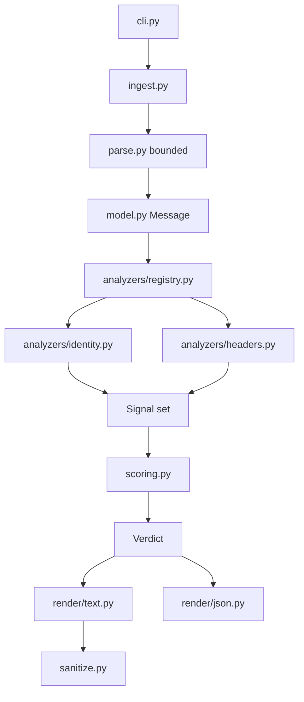
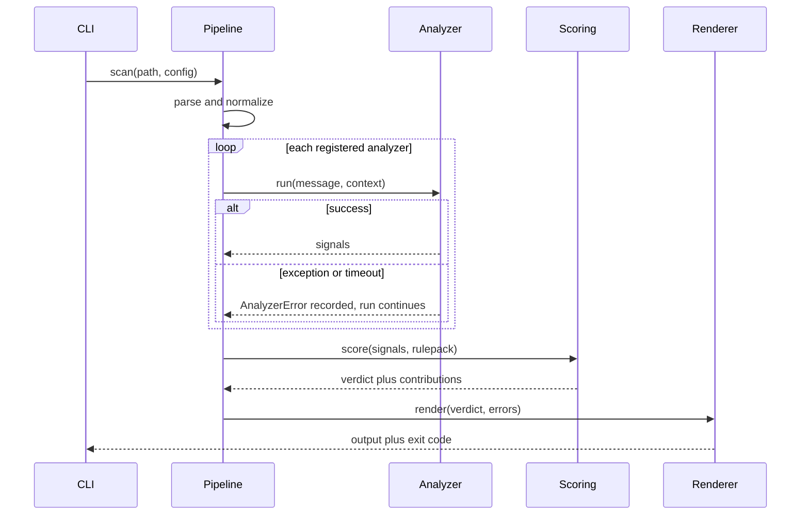

# BaitTrace system design

**One-line scope:** an offline-first, explainable phishing triage tool that
turns a single email file into an evidence-backed risk verdict, usable as a
CLI, a Python library, and a JSON-emitting pipeline step.

This document is the design the code is written against. Where the two
disagree, the code is wrong.

## 1. Problem, users, and scope

An analyst or a curious user has a suspicious email and needs three answers in
under a minute: is this phishing, what specifically is wrong with it, and what
should I do now. Existing options are either enterprise platforms that require
infrastructure and a license, or scripts that dump raw headers and leave
interpretation to the reader. The gap BaitTrace fills is **explanation**.

**Primary user.** A SOC tier-1 analyst or IT generalist triaging a
user-reported email.

**Secondary users.** A security student learning email authentication, and a
CI pipeline or SOAR playbook that needs a machine-readable verdict.

**In scope.** Parsing RFC 5322 / MIME messages; static analysis of sender
identity, authentication results, routing, URLs, attachments, and body
content; deterministic scoring; multiple report formats; batch processing of
mailboxes; an optional-by-default network enrichment layer.

**Explicit non-goals.** No mail server or MTA integration. No live URL
sandboxing or detonation. No malware unpacking. No machine-learning classifier
in v1. No multi-user web service. No threat-intel platform.

**Success criteria.** A stranger can install it and get a useful verdict
within five minutes of finding the repo. On the curated benign corpus,
false-positive rate stays under the HIGH threshold (score 50). On the
synthetic malicious corpus, every sample scores at or above 50. Every point of
every score is traceable to a documented rule ID. Offline runs are
byte-for-byte reproducible.

This release (M1) implements ingest, parse, identity, headers, scoring, and
text / JSON rendering. The other analyzers are designed here and arrive later;
see [ROADMAP.md](ROADMAP.md).

## 2. Architecture

Dependencies point strictly downward. A renderer never re-reads the message.
An analyzer never knows what the score threshold is.



The `Resolver` is the only component permitted to perform I/O during analysis,
and it is injected. In M1 it is `NullResolver`, which returns `UNAVAILABLE`
for every query. Analyzers are therefore written against missing data from the
first line of code: the offline path is the normal path, not a degraded
special case.



A single analyzer crashing degrades the report; it does not fail the scan. The
report says which analyzer failed, so a partial result is honest rather than
silently incomplete.

## 3. Domain model

The canonical `Message` is the contract between parsing and everything else.

Four modelling decisions that matter:

**Headers are an ordered sequence with duplicates preserved.** A second `From`
header is a real spoofing technique that exploits disagreement between what
the MTA validated and what the mail client displays. A dict-based model
destroys that evidence before an analyzer can see it.

**Every string keeps both raw and decoded forms.** RFC 2047 encoded-word abuse
is only visible if you can compare the two.

**`Routing.trust_boundary_index` is explicit.** `Received` headers below your
own infrastructure are attacker-supplied. Any originating-IP claim is only
meaningful relative to a declared trust boundary.

**`LimitsReport` records truncation.** If a 40 MB attachment was skipped, the
report must say so rather than silently returning "no attachment findings."

## 4. Analyzer subsystem

Every analyzer implements one interface and returns one type:

```python
class Analyzer(Protocol):
    id: str                     # "identity"
    prefix: str                 # "IDN"
    requires_network: bool
    def run(self, msg: Message, ctx: Context) -> Sequence[Signal]: ...
```

Registration is via `importlib.metadata` entry points under the
`baittrace.analyzers` group. The built-in analyzers register through the same
mechanism as third-party ones, so the plugin path is exercised by the project
itself. Loading a plugin executes third-party code in-process; there is no
sandbox, which is why `--no-plugins` exists.

### Rule identity

Every rule has a stable ID in its analyzer's namespace: `IDN0xx`, `HDR0xx`,
and later `AUTH0xx`, `URL0xx`, `ATT0xx`, `CNT0xx`, `RTE0xx`. Each ID has
exactly one file at `docs/rules/<ID>.md`. `tests/test_rule_docs.py` asserts a
bijection between emitted IDs and those files.

IDs are append-only. A retired rule is marked deprecated in its doc and stops
firing; the number is never reused, so historical JSON reports remain
interpretable.

Suppressors (`IDN900` in this release) argue *against* suspicion. A tool that
can only ever escalate is not a triage tool.

### Planned analyzers

| Prefix | Analyzer | Status | Network |
|--------|----------|--------|---------|
| `IDN` | Sender identity | **M1** | no |
| `HDR` | Header hygiene | **M1** | no |
| `URL` | Links | M3 | optional |
| `ATT` | Attachments | M3 | optional |
| `AUTH` | SPF / DKIM / DMARC | M4 | optional |
| `RTE` | Routing | M4 | optional |
| `CNT` | Content | M5 | no |

## 5. Scoring

See [SCORING.md](SCORING.md). The short version: per-category caps, noisy-OR
combination with per-class ceilings, a trust factor from suppressors, and
leave-one-category-out attribution so the displayed `+24` lines sum to the
score. All constants live in `src/baittrace/rulepacks/core-2026.08.toml`.
Changing a weight is a rulepack version bump, not a silent behaviour change.

Bands: BENIGN 0–24, SUSPICIOUS 25–49, HIGH 50–74, CRITICAL 75–100.

With only identity (ceiling 0.50) and headers (ceiling 0.20) implemented, the
highest reachable score is `round(100 × (1 − 0.5 × 0.8)) = 60`. The report
states this rather than letting 100 be assumed.

## 6. Rendering

One `Renderer` protocol, two implementations in M1 (`text`, `json`). Markdown
and HTML arrive later.

The text renderer uses a fixed 72-column grid: label columns 1–11, two-space
gutter, value columns 14–72 with a hanging indent. Severity glyphs sit in
column 1. Colour is never load-bearing: every severity is also a glyph and a
word, and colour is disabled when stdout is not a TTY or `NO_COLOR` is set.

Two safety rules: **defang every URL** (`hxxps://micros0ft-login[.]example`)
and **sanitize every attacker-controlled string** before printing. Display
names and filenames go straight to a terminal.

JSON is a published contract. `baittrace schema` prints the JSON Schema.
Adding a field is a minor version; removing or retyping one is a major
version. See [COMPATIBILITY.md](../COMPATIBILITY.md).

## 7. Threat model of the tool itself

The entire input is attacker-controlled data crafted to harm the recipient.
The parser is the attack surface. See [THREAT_MODEL.md](THREAT_MODEL.md).

Hard caps applied before the MIME parser allocates anything proportional to
the input: 25 MB file, depth 20, 200 parts, 500 headers, 4 MB decoded body,
5 second wall-clock budget.

## 8. Configuration

TOML only, parsed with `tomllib`. Discovery: `--config`, then
`./baittrace.toml`, then `$XDG_CONFIG_HOME/baittrace/config.toml`.

Users configure their own domains, executive names, trusted relays,
allowlists, disabled rules, and weight overrides. Unknown keys are errors,
not silent no-ops.

## 9. Testing

| Layer | What it proves |
|-------|----------------|
| Unit per analyzer | each rule fires on a crafted positive and stays silent on a crafted negative |
| Golden files | renderer output is byte-stable |
| Property tests | the parser never crashes, hangs, or exceeds limits on arbitrary MIME |
| Corpus regression | benign stays under 25, malicious stays at or above 50 |
| Schema conformance | every report validates against the published JSON Schema |
| Limit tests | oversized files, deep MIME, and header floods are refused safely |
| Rule-doc bijection | no rule exists without documentation and vice versa |
| Offline guarantee | scanning opens no sockets |
| Data freshness | vendored suffix list is not ancient |

The benign-corpus false-positive ceiling is the single most valuable test in
the project. Any heuristic can find phishing if it flags everything.

## 10. Repository layout

```
src/baittrace/          package
  analyzers/            identity, headers, registry
  render/               text, json, layout grid
  rulepacks/            core-2026.08.toml
  data/                 brands, confusables, public suffix list, freemail
tests/                  unit, property, golden, limits, corpus
corpus/                 synthetic samples plus generator.py
docs/                   this file, scoring, threat model, roadmap, rules/
.github/                CI, Dependabot, issue and PR templates
```

Runtime dependency count: zero. Dev: pytest, hypothesis, jsonschema, ruff,
mypy, pre-commit. Python is the right language because of the `email`
standard library; rewriting that in Go or Rust would be most of the project.

## 11. Risks and alternatives

The dominant risk is **false positives eroding trust**, mitigated by the
enforced benign-corpus ceiling, the low header-analyzer ceiling, and the
trust-factor suppressors. Second is **corpus legality and safety**, mitigated
by the synthetic-only policy. Third is **scope creep**, mitigated by the
explicit non-goals and the M1–M3 discipline.

Alternatives considered and rejected: a machine-learning classifier (v1
explainability is the product); Go or Rust (the email ecosystem is in
Python); a web service as the primary artefact (turns a single-maintainer
tool into an operational burden); full-additive scoring (no saturation; kept
behind a rulepack flag).

The design's centre of gravity is three things: the `Signal` schema, which
makes explainability structural; the offline-first injected resolver, which
makes the tool safe and testable by construction; and the false-positive
budget in CI, which keeps detections honest as the rule count grows.
