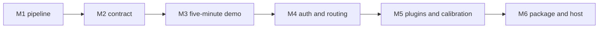

# Roadmap

Ship M1 through M3 before adding anything to this list. The tool is genuinely
useful and fully demonstrable at M3; everything after is depth, and depth is
only valuable on top of something that works.

## M1 — pipeline (shipped)

Ingest, bounded parse, canonical `Message`, identity analyzer (IDN001–IDN005,
IDN900), header analyzer (HDR001–HDR005), scoring engine, text and JSON
renderers, CLI, tests, documentation, CI, synthetic corpus.

**Done when** `baittrace scan corpus/malicious/brand-lookalike.eml` prints a
real verdict, the parser survives the property suite, and the benign corpus
stays under 25.

## M2 — the contract

Config file end-to-end, `--fail-on` used in a documented shell pipeline,
JSON Schema published as an artefact, `COMPATIBILITY.md` treated as a
surface. Mostly already present in M1; M2 is the polish pass that treats the
JSON document as something other people depend on.

**Done when** a consumer can validate every report against `baittrace schema`
and pin a rulepack.

## M3 — the five-minute demo (this pass)

`URL` and `ATT` analyzers, AUTH reported + verified modes, sectioned report
matching the instructor mock. `baittrace scan corpus/malicious/instructor-demo.eml`
covers sender, SPF/DKIM/DMARC, links and HTML attachments.

**Done when** the five-minute demo runs end to end offline and the benign corpus
is still under 25.

## M4 — authentication and routing

`AUTH` verified mode is in M3. M4 adds `RTE` with an explicit trust boundary,
a replay `Resolver`, and `--record` / `--replay` so online scans are
reproducible.

**Done when** DMARC alignment is correct on a hand-checked fixture set, and
an online scan can be replayed offline from a recorded bundle.

## M5 — community-ready

Documented plugin entry points (already wired), CONTRIBUTING walkthrough
(already written), docs site, calibration harness that publishes precision /
recall / a threshold sweep as a CI artefact on every rulepack change.
`CNT` content analyzer, weighted low on purpose.

**Done when** an external contributor can ship a rule without touching core.

## M6 — package and host

PyPI release via trusted publishing, Docker image (non-root, pinned digest),
`baittrace batch` over mbox, HTML report. Railway-hosted demo API that:

- never stores uploaded emails
- forces `online=False` server-side
- runs analysis in a process pool with memory and CPU limits
- logs sha256 / size / score / band / duration, never message content

**Done when** `pip install baittrace` works and a recruiter can open a URL.

Railway is the right host for the demo and the wrong host to start before M3.
An empty project with nothing to deploy is not progress.

## Explicitly not on this list

- A machine-learning classifier
- Live URL detonation or HTML rendering
- Multi-user accounts, dashboards, stored history
- Competing with a SAST product or a SIEM
- Committing real phishing samples
