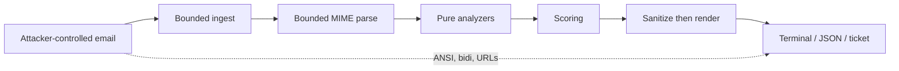

# Threat model of the tool itself

BaitTrace's entire input is attacker-controlled data that was specifically
crafted to harm the recipient. The parser is the attack surface. This page is
the inventory of ways the tool can be turned against its operator, and what
the code does about each.

The dashed path is the one that has to be closed: nothing that originated in
the message may reach a terminal, a browser, or a ticket without passing
through `sanitize.py`.

## Threats

| Threat | Vector | Mitigation |
|--------|--------|------------|
| Resource exhaustion | Zip bomb, deeply nested MIME, 500 MB attachment, millions of parts | Hard caps: 25 MB file, depth 20, 200 parts, 500 headers, 4 MB decoded body, 5 s per-message budget. Soft caps truncate and record a `LimitsReport` |
| Terminal injection | ANSI escapes or bidi overrides in a filename or display name printed to a TTY | `sanitize.py` strips C0/C1 except tab, strips CSI/OSC, replaces U+202A–U+202E and U+2066–U+2069 with visible tokens like `<RLO>` |
| Report forgery | A display name containing a newline and a plausible-looking finding line | Line breaks in attacker text become spaces. The report's structure is not something the message can write |
| Clickable delivery | A live `https://` URL in a report that an analyst pastes into a ticket | Every URL is defanged (`hxxps://…[.]example`) in every output format. Tests assert `http://` never appears in a text report |
| Path traversal | Attachment filename `../../.ssh/authorized_keys` during extraction | M1 never writes attachments to disk. When `--extract` arrives, sanitize to a basename under a created directory |
| ReDoS | Crafted header defeating a backtracking regex | Avoid nested quantifiers, bound repetition, property-test the parser, per-message time budget |
| Beaconing | Fetching a tracking pixel or following a link tells the attacker the mail was read | Offline default. M1 has no network path at all: `NullResolver` returns `UNAVAILABLE`. Tests monkeypatch `socket` to make a connection fatal |
| SSRF | Redirect chain pointed at `169.254.169.254` | No HTTP client in this release. When `--follow-redirects` arrives: scheme allowlist, block loopback/private/link-local/metadata, cap hops, no cookies |
| Unsafe deserialization | Config or cache as YAML or pickle | TOML via `tomllib` for config. Never pickle |
| Supply chain | Malicious dependency or unpinned Action | Zero runtime dependencies. Actions pinned to commit SHAs. Dependabot. Minimal `permissions` on CI jobs |
| Sample leakage | Real phish with victim PII committed to a public repo | Synthetic malicious corpus only. `.gitignore` plus a pre-commit hook blocking `.eml` outside `corpus/`. `--redact` output mode |
| Plugin trust | Third-party analyzer loaded via entry point runs arbitrary code | Documented as a trust decision. `--no-plugins` escape hatch. `baittrace rules` shows provenance. No false claim of sandboxing |
| Log leakage (future hosted API) | Request-body logging of a real email | Design constraint: logs record sha256, size, score, band, duration — never a header, URL, filename, or address |

## Parser bounds

Applied in `limits.py` **before** the MIME parser is allowed to allocate
anything proportional to the input.

| Bound | Default | On exceed |
|-------|---------|-----------|
| File size | 25 MiB | `LimitExceeded` (fatal for that message) |
| MIME depth | 20 | truncation recorded |
| MIME parts | 200 | truncation recorded |
| Headers | 500 | truncation recorded |
| Single header | 16 KiB | truncation recorded |
| Decoded body | 4 MiB | truncation recorded |
| Extracted URLs | 500 | truncation recorded |
| Wall clock | 5 s | remaining analyzers skipped, recorded as errors |

A hard bound raises `LimitExceeded` because the message is unanalyzable and
pretending otherwise would be dishonest. A soft bound truncates and records,
because a triage tool that quietly omits a check is worse than one that
admits uncertainty.

## Sanitization

Three classes of problem, all handled in `sanitize.py` before any renderer
prints:

1. **Terminal control.** CSI, OSC, and single-character ESC sequences are
   stripped. A filename containing `\x1b[2J` must not erase the analyst's
   scrollback.
2. **Direction overrides.** `invoice\u202Egnp.exe` renders as `invoiceexe.png`
   while remaining an executable. Override characters are replaced with
   visible tokens (`<RLO>`), not removed, because their presence is itself
   the finding.
3. **Invisible characters.** Zero-width spaces and joiners used to break
   keyword matching become `<ZWSP>`, `<ZWJ>`, and so on.

`--redact` additionally masks local-parts of email addresses and IPv4
addresses so a report can be shared without publishing the victim.

## Corpus and git history

Public git history is permanent and is scraped within minutes of a push. A
real phishing sample carries the recipient's name and address, usually a
quoted business thread, and frequently a live malware payload.

The policy is in [corpus/README.md](../corpus/README.md) and is load-bearing:

- Malicious samples are authored by `corpus/generator.py` using RFC 2606 /
  RFC 6761 reserved domains and documentation IP ranges.
- `.gitignore` excludes `*.eml`, `*.msg`, `*.mbox` everywhere except `corpus/`.
- `tools/check_email_samples.py` is a pre-commit hook that `git add -f`
  cannot bypass.
- CI runs `python corpus/generator.py --check` so committed samples cannot
  drift from the generator.

Analyse a real sample locally. Do not commit it.

## What this release does not claim

M1 does not sandbox plugins, does not isolate the parser in a child process,
and does not have an HTTP client to harden. Process isolation and SSRF guards
belong to the hosted service (M6) and the online resolver (M4) respectively.
Claiming them now would be a lie; designing the seams so they can be added
without a rewrite is the actual commitment.
